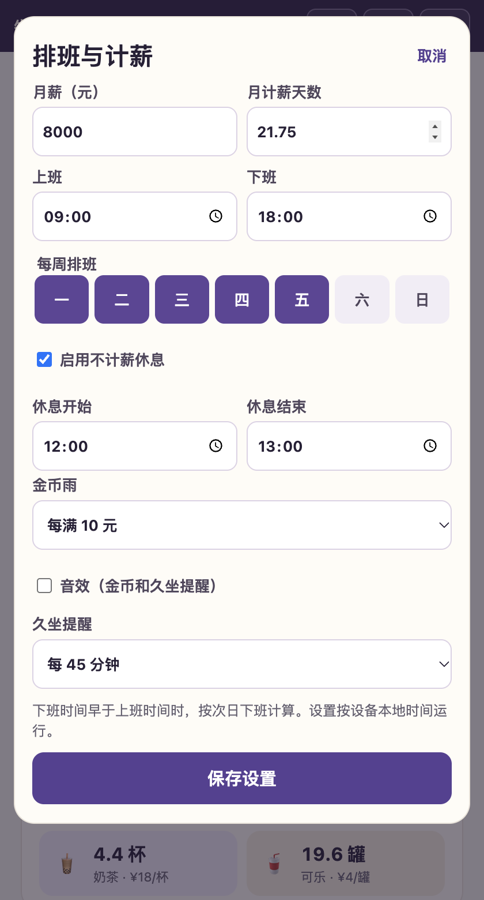
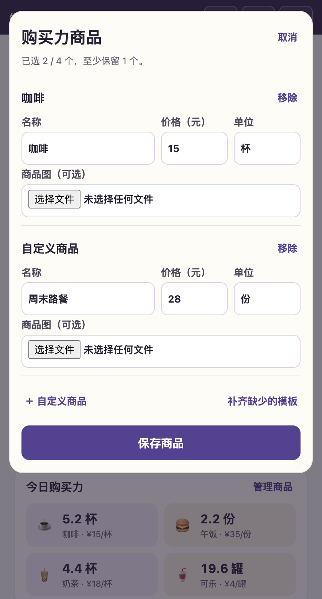
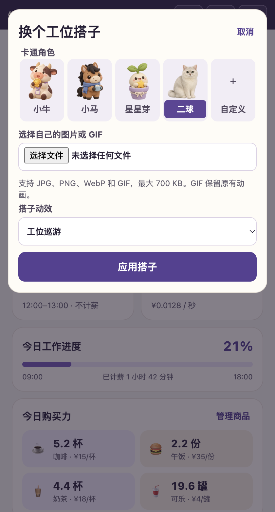

# 牛马鼓励器

**加油打工人，搭子陪你倒数下班。**

打开就能看到离午休和下班还有多久、今天工作到了哪一步。小牛会举金币，小马会抿咖啡，星星芽会抱着星星打盹，二球会在工位巡游、舔爪，也会抬爪打招呼。

## 下载 v1.3.4

打开 [v1.3.4 Release](https://github.com/GeminiGuy/niuma-encourager/releases/tag/v1.3.4)，按设备选择附件。

| 版本 | Release 附件 | 怎么打开 |
| --- | --- | --- |
| Mac Apple Silicon（M 系列） | `niuma-v1.3.4-macos-arm64.zip` | 解压后打开「牛马鼓励器.app」，需 macOS 13 或更高版本 |
| Mac Intel | `niuma-v1.3.4-macos-x64.zip` | 解压后打开「牛马鼓励器.app」，需 macOS 13 或更高版本 |
| Windows 10 64 位 | `niuma-v1.3.4-windows10-x64.zip` | 解压整个文件夹，双击 `Niuma.exe` |
| 小红书小工具 H5 | `niuma-v1.3.4-h5-xiaohongshu.zip` | 在创作服务平台的 Builder Hub 上传和预览；日常使用可在小红书 App 内打开已挂载的小工具 |

Mac 版使用本地签名，尚未通过 Apple 公证。Windows 包没有发行签名。Apple Silicon 版已在真机验证置顶、迷你窗口、隐藏恢复及重开保留设置。Intel Mac 和 Windows 10 包已校验文件与架构，待相应设备运行验证。

## 功能与界面

以下为 v1.3.4 macOS 桌面版的实际界面。截图里的收入和待办为演示数据。

### 首页 · 看时间、进度和收入

- **下班与午休倒计时**：按排班显示离上班、午休或下班还有多久。休息日会倒数到下次上班。
- **今日工作进度**：按已计薪工时和当班有效工时计算。启用午休时，午休期间收入和工时进度暂停累积。
- **今日已赚**：根据月薪、月计薪天数和有效工时实时估算。可一键隐藏收入和购买力数字。金额仅供娱乐。
- **待办与久坐提醒**：可以添加、勾选和移除今日待办。提醒在上班时段、页面可见时计时，点「我活动了」重新计时。

### 设置 · 按自己的排班计时

在「设置」里填月薪和月计薪天数，选每周排班日、上下班时间和不计薪休息时段。下班时间早于上班时间时按次日下班处理。金币雨可选每满 1 元、每满 10 元或关闭。金币和久坐提示音默认关闭，可以在这里开启。

### 今日购买力 · 把收入换算成日常小目标

默认展示咖啡、午饭、奶茶和可乐。「管理商品」可以修改价格和单位，也可以换成自己的商品，比如一份周末徒步路餐，配上自选图片。模板和自定义商品合计可保留 1–4 个。

### 工位搭子 · 选角色、换动作

点首页卡片右上角的「换搭子」可选小牛、小马、星星芽或二球，每个角色都有自己的动作，也可以选静止。二球支持工位巡游、舔爪子和单爪打招呼。你也可以选自己的图片或 GIF，工位搭子卡片里的打气语录可以随时换一句。

### 迷你悬浮窗 · 只看最常用的数字

桌面版点「迷你」会收成小窗，保留下班倒计时、今日收入和搭子。点「置顶」让窗口浮在其他应用上方，点「隐藏」后可以从 Mac 菜单栏或 Windows 系统托盘恢复。

桌面版的设置和自定义素材保存在设备本地，编辑无需账号。小红书 v1.3.4 的自定义搭子和商品编辑依赖平台的关注状态，工具能否打开也受客户端和账号可用性影响。

## 项目目录

| 路径 | 内容 |
| --- | --- |
| [`h5/`](h5/) | 已发布的小红书 H5 v1.3.4 源码与资源 |
| [`desktop/app/`](desktop/app/) | 桌面应用、窗口交互及本地 UI |
| [`desktop/package-desktop.py`](desktop/package-desktop.py) | 生成三种桌面包的打包脚本 |
| [`docs/`](docs/) | 预览图与发布说明 |

桌面打包方式见 [构建与发布](docs/build.md)。本项目源码与角色素材目前尚未声明开源许可证。Electron 和 Chromium 的许可声明随桌面发行包提供。
